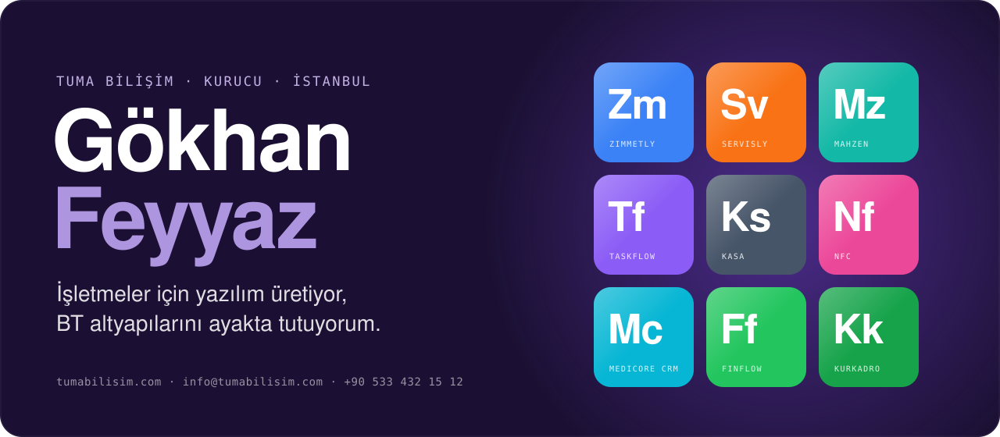
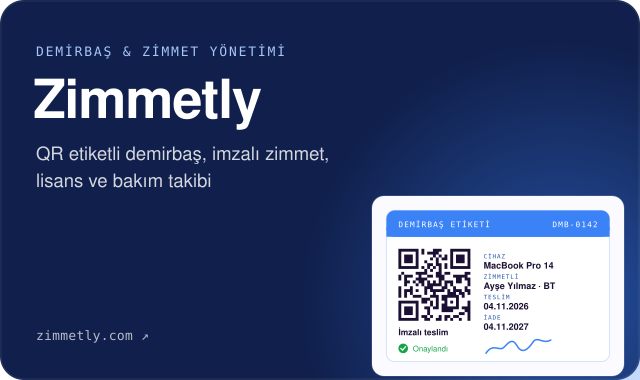
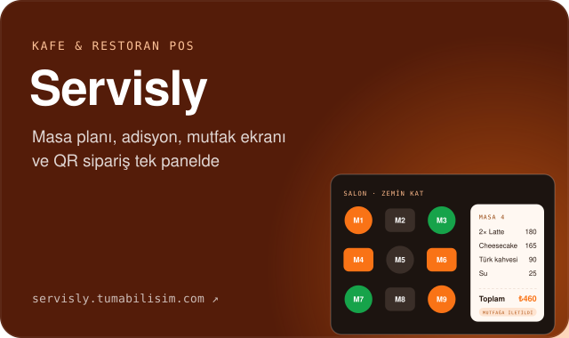
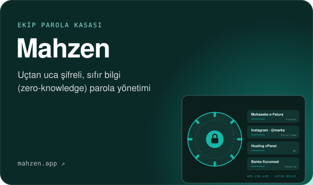
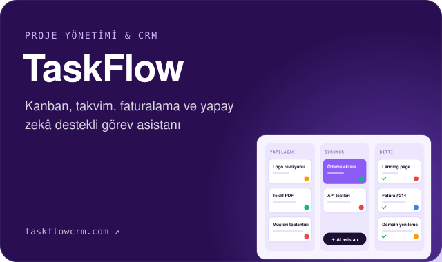
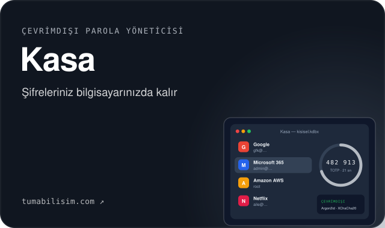
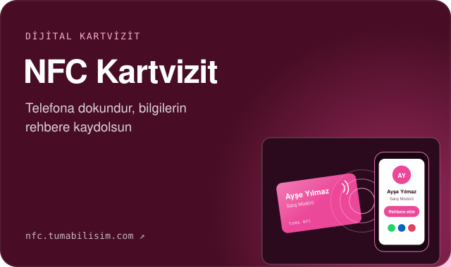
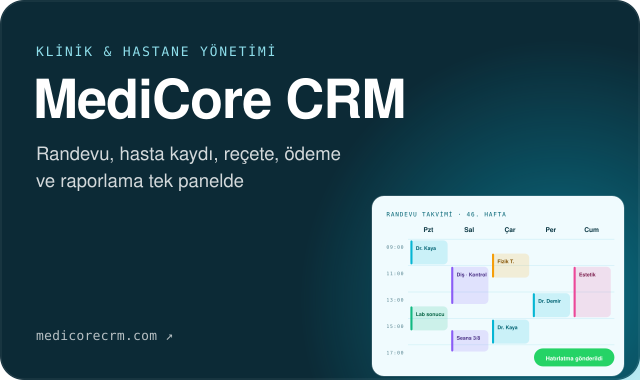
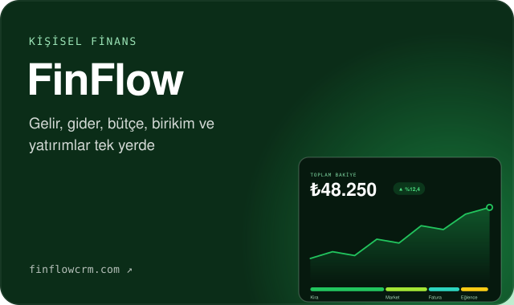
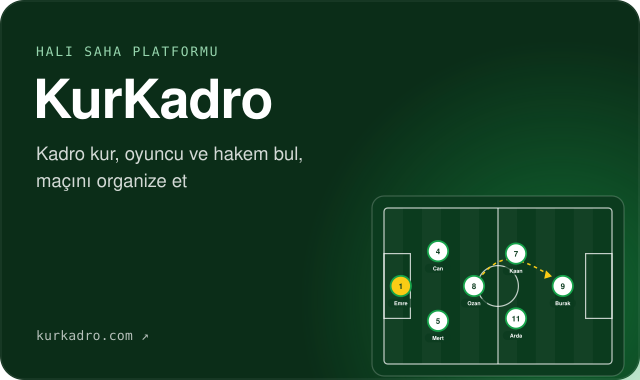

  

  
  
  
  
  

## 👋 Merhaba, ben Gökhan

İstanbul merkezli **[Tuma Bilişim](https://tumabilisim.com)**'in kurucusuyum. İşletmelere iki konuda yardım ediyorum:

- **Yazılım:** İşinize özel web uygulamaları, SaaS ürünleri, masaüstü uygulamalar ve kurumsal web siteleri.
- **Kurumsal BT:** Microsoft 365 ve Google Workspace, sunucu ve ağ, siber güvenlik, yedekleme ve 7/24 BT desteği.

Yıllardır kurumsal BT yöneticiliği yapıyorum; yazdığım yazılımlar da bu sahadaki gerçek ihtiyaçlardan çıkıyor. Hedefim her zaman aynı: **kurulumu kolay, hemen kullanılabilen ve rakiplerinden geri kalmayan ürünler.**

> 💡 Aşağıdaki ürünlerden birini kullanmak, işletmenize uyarlatmak ya da sıfırdan bir proje konuşmak isterseniz [bana yazın](#-iletişim).

## 🚀 Ürünler

Karta tıklayınca ürünün tanıtım sayfası, oradan da canlı ürün açılır.

## 🛠️ Neler yapıyorum?

| | Hizmet | Kapsam |
|:-:|---|---|
| 💻 | **Özel yazılım & SaaS** | Çok kiracılı (multi-tenant) web uygulamaları, yönetim panelleri, abonelik sistemleri |
| 🌐 | **Web siteleri** | Kurumsal site, landing page, özel WordPress temaları |
| 🖥️ | **Masaüstü uygulamalar** | Tauri ile hafif ve güvenli Windows uygulamaları |
| 🔗 | **Entegrasyonlar** | WhatsApp Cloud API, Microsoft 365 / Gmail OAuth2, ödeme ve yapay zekâ entegrasyonları |
| 🏢 | **Kurumsal BT** | M365 / Google Workspace geçişi, sunucu, ağ, güvenlik duvarı, yedekleme, BT dış kaynak |
| 🛡️ | **Siber güvenlik** | BT denetimi, güvenlik farkındalık eğitimi, uç nokta yönetimi |

## ⚙️ Teknolojiler

## 🤝 Nasıl çalışıyoruz?

1. **Tanışma:** İhtiyacınızı dinliyorum, kısa bir görüşmeyle kapsamı netleştiriyoruz.
2. **Teklif:** Net kapsam, süre ve fiyat içeren yazılı teklif.
3. **Geliştirme:** Ara teslimlerle, ilerlemeyi canlı görerek.
4. **Teslim & destek:** Kurulum, eğitim ve sonrasında destek.

## 📬 İletişim

- 🌐 **Web:** [tumabilisim.com](https://tumabilisim.com) · [Teklif formu](https://tumabilisim.com/iletisim)
- ✉️ **E-posta:** [info@tumabilisim.com](mailto:info@tumabilisim.com)
- 💬 **WhatsApp / Telefon:** [+90 533 432 15 12](https://wa.me/905334321512?text=Merhaba%2C%20GitHub%20profilinizden%20ula%C5%9F%C4%B1yorum.)
- 💼 **LinkedIn:** [gokhanfeyyaz](https://linkedin.com/in/gokhanfeyyaz) · 📸 **Instagram:** [@tumabilisim](https://www.instagram.com/tumabilisim/)

---

<b>🇬🇧 English</b>

 

Hi, I'm **Gökhan**, founder of **[Tuma Bilişim](https://tumabilisim.com)**, an Istanbul-based software and IT services company.

I build custom web apps, multi-tenant SaaS products and lightweight desktop apps, and I help businesses run their IT: Microsoft 365 / Google Workspace, servers, networking, security and backups.

**Products:** [Zimmetly](https://zimmetly.com/tanitim.php), [Servisly](https://servisly.tumabilisim.com/), [Mahzen](https://mahzen.app), [TaskFlow](https://taskflowcrm.com/), [Kasa](https://tumabilisim.com/kasa/), [Tuma NFC Kartvizit](https://nfc.tumabilisim.com), [MediCore CRM](https://medicorecrm.com), [FinFlow](https://finflowcrm.com), [KurKadro](https://kurkadro.com).

**Let's talk:** [info@tumabilisim.com](mailto:info@tumabilisim.com) · WhatsApp [+90 533 432 15 12](https://wa.me/905334321512) · [LinkedIn](https://linkedin.com/in/gokhanfeyyaz)

